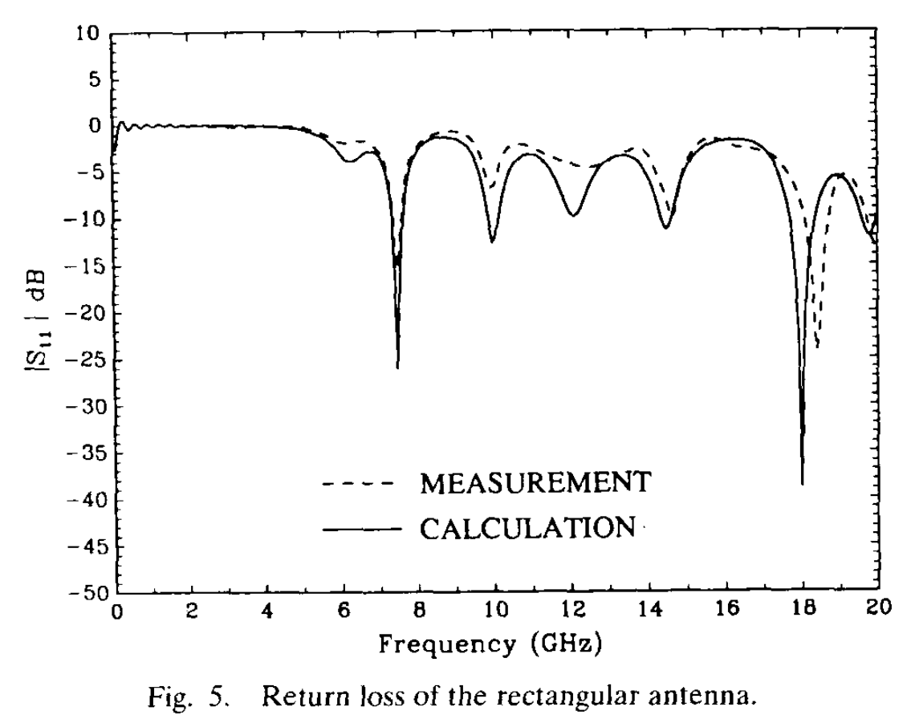
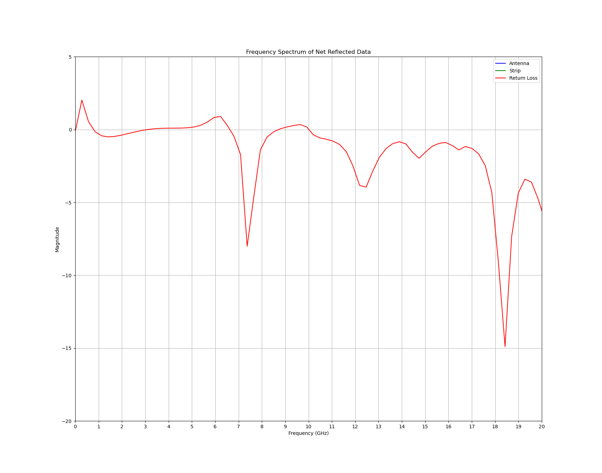
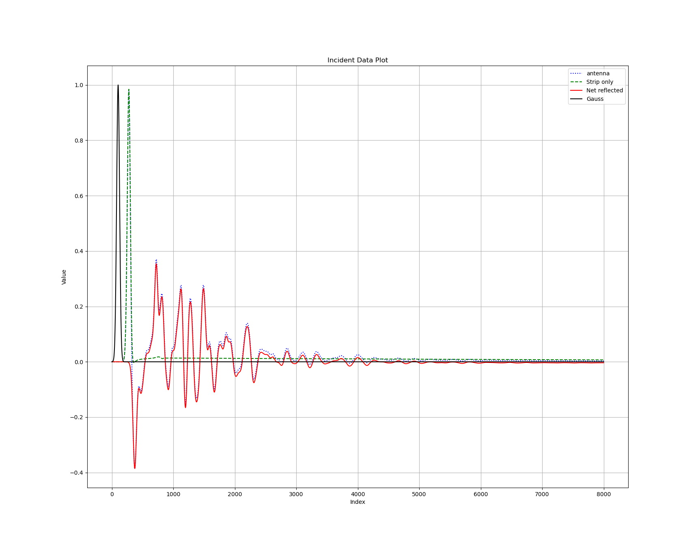

# Patch Antenna FDTD Simulation with CUDA acceleration

by 林萬荃 at National Taiwan University

## Description

This project is a CUDA-accelerated FDTD simulation of a patch antenna. The simulation is based on the paper by Sheen et al. [1]. The original code is written in C++ and is available from [Pete Bevelacqua's website](https://www.antenna-theory.com/antennas/patches/patch6.php) [2]. The original code is modified to use CUDA for acceleration.

### Requirements

- NVIDIA GPU and a working NVIDIA driver (`nvidia-smi`)
- CUDA Toolkit (`nvcc`), GNU Make, and a compatible C++ compiler
- Python 3.10 or newer with NumPy, Matplotlib, and tqdm
- FFmpeg for video export; the default uses `libx264`. NVIDIA encoding is optional.

Verified locally with an RTX 4060, CUDA 12.9, GCC 13.3, and Python 3.12.
No Python CUDA package is required.

## Run the simulation

Optional isolated Python environment:

```bash
python3 -m venv .venv
source .venv/bin/activate
python3 -m pip install -r requirements.txt
```

Run from the project directory:

```bash
python3 simulate.py
# Or choose a new output directory:
python3 simulate.py --output runs/my-experiment
# Shell wrapper accepts the same arguments:
bash run.sh --output runs/another-experiment
```

The runner builds separate antenna and strip-reference executables, then runs
both. Existing run directories are rejected to prevent accidental overwrites.
If execution fails, inspect `simulation.log` in the relevant subdirectory;
`metadata.json` records whether the run completed. GPU access must be available
to the process (a sandbox or container may hide GPU devices).

```text
runs/my-experiment/
  metadata.json
  antenna/
    fields.npy
    Incident.txt
    Gauss.txt
    simulation.log
  strip/
    fields.npy
    Incident_strip.txt
    Gauss.txt
    simulation.log
```

`fields.npy` contains float64 Ez samples in `(frame, x, y)` order. Each file is
about 73 MiB, with 1,600 frames of 60 × 100 samples. It stores the z=2 slice
every five simulation steps, starting at step zero after the first field update.
It preserves full double precision instead of rounding fields to six decimals.
NumPy can read individual frames without loading the entire array:

```python
import numpy as np
fields = np.load("runs/my-experiment/antenna/fields.npy", mmap_mode="r")
frame = fields[100]
```

Grid spacing, time step, frame interval, and run status are in `metadata.json`.
The numerical grid and solver parameters remain compile-time constants. If you
change them in `main.cu`, update the metadata constants in `simulate.py` as well.

## Plot and export

```bash
python3 plotEz.py runs/my-experiment
python3 plotCPU.py runs/my-experiment
# Quick preview:
python3 plotCPU.py runs/my-experiment --max-frames 30 --output preview.mp4
# Optional NVIDIA encoder:
python3 plotCPU.py runs/my-experiment --codec h264_nvenc --output gpu.mp4
```

The waveform and reflection plots are saved as PNGs inside the run directory.
The animation is streamed directly to FFmpeg as `fields.mp4`; no intermediate
PNG directory is needed. `--stride 5` renders every fifth stored frame.
Video output paths must not already exist. Plotting works without a display.

The reflection calculation retains the original `/3` scaling and Gaussian-source
normalization. It is not a newly calibrated port S11 calculation. Frequencies
with negligible source energy are masked to avoid meaningless division results.
Animation timestamps include the five-step sampling interval.

To display the original antenna geometry interactively:

```bash
python3 model.py
```

## Build targets and original CPU reference

```bash
make main    # build/fdtd and build/fdtd-strip
make cpu     # build/fdtd-cpu
make clean   # remove compiled binaries; keep simulation results
```

The CUDA executables write into their current working directory. Prefer the
Python runner, which isolates outputs and supplies metadata. The original CPU
solver is retained for reference and still writes the legacy text files; it is
not integrated into the new plotting workflow. Old `junk/` output is likewise
not consumed by the new plotters. Existing images and the report are retained.

To check the NumPy file writer and result validation:

```bash
python3 -m unittest discover -s tests -v
```

## Results

<div align="center">
    
</div>
This is the electric field under the patch antenna. The electric field is excited by a Gaussian pulse at the feed line.

> Note that the simulation is sample every 5 time steps. So 1600 frames correspond to 8000 time steps.

<div align="center">
    
    
</div>
On the right is the return loss of the patch antenna measured and computed by the original paper. On the left is the return loss of the patch antenna computed by the CUDA-accelerated FDTD simulation.

<div align="center">
    
</div>
This is the time waveform of the electric field under the feed line.

## Reference

[1]
D. M. Sheen, S. M. Ali, M. D. Abouzahra and J. A. Kong, "Application of the three-dimensional finite-difference time-domain method to the analysis of planar microstrip circuits," in IEEE Transactions on Microwave Theory and Techniques, vol. 38, no. 7, pp. 849-857, July 1990, doi: 10.1109/22.55775. keywords: {Finite difference methods;Time domain analysis;Microstrip antennas;Microstrip components;Circuits;Antenna accessories;Impedance;Patch antennas;Frequency;Scattering parameters}

[2]
[Source code from Pete Bevelacqua - EE 517](https://www.antenna-theory.com/antennas/patches/patch6.php)
